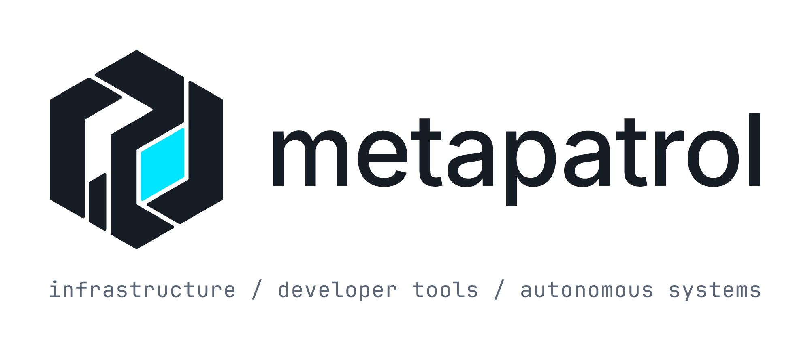
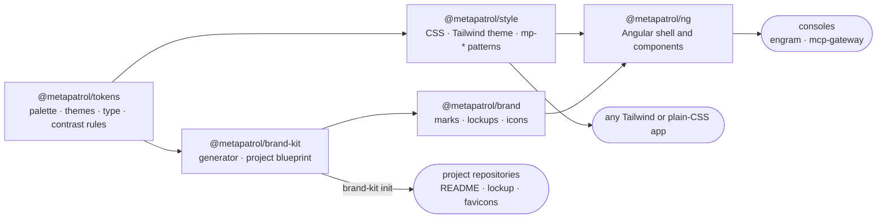

<p align="center">
  <picture>
    <source media="(prefers-color-scheme: dark)" srcset="packages/brand/lockup/metapatrol-lockup-descriptor-dark.png">
    
  </picture>
</p>

<p align="center">
  <strong>The metapatrol identity as code: one look for every project, from a version bump.</strong>
</p>

<p align="center">
  <a href="https://github.com/metapatrol/brand/releases"></a>
  <a href="LICENSE"></a>
  <a href="https://github.com/orgs/metapatrol/packages?repo_name=brand"></a>
  
  
</p>

<p align="center">
  <a href="identity/brand-identity.md">Identity</a> ·
  <a href="#packages">Packages</a> ·
  <a href="examples">Examples</a> ·
  <a href="ROADMAP.md">Roadmap</a> ·
  <a href="CONTRIBUTING.md">Contributing</a> ·
  <a href="SECURITY.md">Security</a> ·
  <a href="TRADEMARKS.md">Trademarks</a>
</p>

---

## Why

metapatrol is a family of projects — infrastructure, developer tools,
autonomous systems — and each of them has a console, a README and a place on
GitHub. Copying a logo, a palette and a sidebar into every one of them gives
as many slightly different looks, and every change to the brand becomes a
change in every repository.

This repository is the brand as code instead. The mark is constructed, not
drawn; the colours are tokens whose contrast is checked in CI; styles,
components and the generated assets are packages. A project takes them as
dependencies, and a new version of the brand reaches it as a version bump.

## How it works



- **One version for all five packages**, released together from conventional
  commits, so a project never mixes a style of one release with components of
  another.
- **Generated, then committed.** The assets in `packages/brand` are written by
  the generator and committed, so every change to a mark is visible in review;
  CI fails when they do not match what the generator writes.
- **Checked, not trusted.** Both themes are held to WCAG contrast rules
  (`packages/tokens/tokens/contrast.json`) before anything is built.

## Packages

| package | what it is |
|---|---|
| [`@metapatrol/tokens`](packages/tokens) | design tokens (DTCG): palette, both themes, type, radii, the mark's construction; the WCAG contrast rules both themes must meet; CSS, SCSS and JSON outputs |
| [`@metapatrol/style`](packages/style) | fonts, themes, element defaults, the `mp-*` patterns, the Tailwind CSS v4 theme (one import), the shadcn/spartan mapping, a Sass API |
| [`@metapatrol/brand-kit`](packages/brand-kit) | the generator — mark, wordmark, lockups, app icons, favicons as SVG, PNG and ICO — and `init`, the blueprint for a project repository |
| [`@metapatrol/brand`](packages/brand) | the generated assets (all rights reserved, see [TRADEMARKS.md](TRADEMARKS.md)) |
| [`@metapatrol/ng`](packages/ng) | Angular components: the app shell (sidebar with counts, namespace, navigation, theme, account), page header, tables with sort and search, conditions, notices, load states, tooltips, code viewer, Markdown |

Also here: [`examples/`](examples) (Angular + Tailwind, React + Vite + Tailwind)
and [`apps/preview`](apps/preview), the brand site.

## Quick start

The packages are published to GitHub Packages. Its npm registry wants a token
even for reading — a personal access token with `read:packages`, or a
workflow's `GITHUB_TOKEN` — and one line per project points the `@metapatrol`
scope at it, in `.npmrc`:

```
@metapatrol:registry=https://npm.pkg.github.com
//npm.pkg.github.com/:_authToken=${NPM_TOKEN}
```

**Angular or any Tailwind CSS v4 app** — `npm install @metapatrol/style`, then
in `src/styles.css` replace `@import "tailwindcss";` with

```css
@import "@metapatrol/style/tailwind.css";
```

Utilities are named after the tokens (`bg-surface`, `text-fg-muted`,
`border-line-strong`, `bg-signal text-on-signal`); the default Tailwind palette
is removed. Themes follow the system, or `data-theme="dark|light"` on any
element. React with shadcn/ui adds `@import "@metapatrol/style/shadcn.css";`.

**An Angular console** — `npm install @metapatrol/ng`, and the frame is one
component:

```html
<mp-app-shell project="engram" [nav]="nav" home="/overview">
  <router-outlet />
</mp-app-shell>
```

Details: [packages/style](packages/style/README.md),
[packages/ng](packages/ng/README.md); working code: [examples/](examples).

**A project repository** — `npx @metapatrol/brand-kit init` writes
`metapatrol.json`, the project lockup `metapatrol / <name>`, a social preview,
the favicon set and a README header, and — where there are none — a README
skeleton, `CONTRIBUTING.md` and `SECURITY.md`, all written for the project's
GitHub mirror. See [packages/brand-kit](packages/brand-kit/README.md) and
*brand levels* in the [identity document](identity/brand-identity.md).

**Without a package** — every release has its assets as
`metapatrol-brand-X.Y.Z.zip` on the [releases page](https://github.com/metapatrol/brand/releases).

### Inside the metapatrol network

The same packages come from the forge's own npm registry
(`https://forgejo.metapatrol.local/api/packages/metapatrol/npm/`, with a token
that has `read:package`). The brand site with every file for download, and the
shell preview, are at `https://brand.metapatrol.local` and
`https://brand.metapatrol.local/shell/`; the assets are served at
`/assets/<version>/…` (never changes) and `/assets/latest/…` (follows releases).
All of these sit behind the forge's login and are not reachable from outside.

## Working on it

Requirements: Node.js `^22.22.3 || ^24.15.0 || >=26` (`nvm use` reads `.nvmrc`)
and `make`.

```sh
make install     # npm ci
make build       # tokens → style → brand-kit → assets → examples → preview
make test
make ci          # everything CI runs, in the same order
make             # every target
```

| to change | edit | then |
|---|---|---|
| a colour, a theme, type, radii | `packages/tokens/tokens/*.tokens.json` | `make check` (contrast), `make assets` if a mark colour changed |
| a contrast requirement | `packages/tokens/tokens/contrast.json` | `make check` |
| the mark's geometry | `packages/brand-kit/src/geometry.ts` | `make assets`, commit `packages/brand` |
| wordmark, lockups, icons | `packages/brand-kit/src/compose.ts` | `make assets`, commit `packages/brand` |
| styles, patterns, Tailwind theme | `packages/style/src/`, `scripts/build.mjs` | `make build test` |
| Angular components | `packages/ng/src/lib/` | `make build test`, `make start-angular` |
| the project blueprint | `packages/brand-kit/src/init.ts`, `project.ts` | `make test` |
| the brand site | `apps/preview/src/app/` | `make start-preview` |

## Releases

The repository is developed in a private Forgejo and push-mirrored here. A
release is cut there, from the conventional commits since the last tag:
`fix:` → patch, `feat:` → minor, breaking → minor while 0.x; `chore:`, `ci:`,
`build:` and `docs:` alone release nothing. One version for all five packages.

The tag reaches GitHub with the mirror, and
[`packages.yml`](.github/workflows/packages.yml) publishes that version to
GitHub Packages and creates the GitHub release. On Forgejo, the same tag
publishes to its own registry and deploys the brand site
([.forgejo/README.md](.forgejo/README.md)). The changes are in
[CHANGELOG.md](CHANGELOG.md).

## Contributing

Issues and pull requests are welcome here on GitHub: see
[CONTRIBUTING.md](CONTRIBUTING.md). Security problems go through
[SECURITY.md](SECURITY.md).

## Licence

The code — tokens, styles, generator, components, examples — is licensed under
the [Apache License 2.0](LICENSE). The metapatrol name, mark, wordmark and
lockups are not: see [TRADEMARKS.md](TRADEMARKS.md) and
[packages/brand/LICENSE.md](packages/brand/LICENSE.md). Inter and JetBrains
Mono are under the SIL Open Font License.
